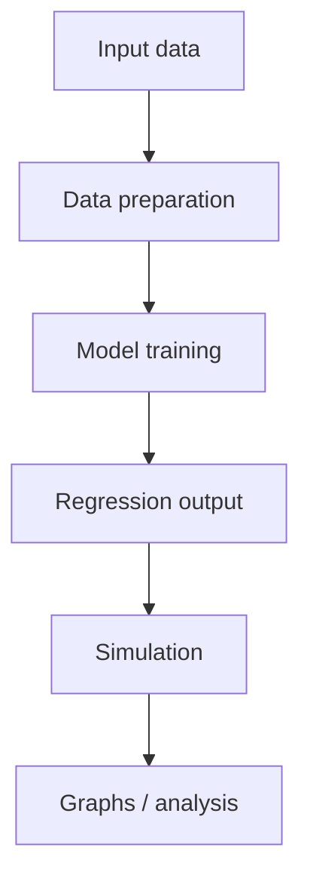

<div align="center">

# Machine Learning — Regression & Simulation

**An experimental workflow combining data processing, multivariable regression, and simulation.**


</div>

## Contents

- [Overview](#overview)
- [Workflow](#workflow)
- [Repository structure](#repository-structure)
- [Technologies](#technologies)
- [Run the project](#run-the-project)
- [Current limitations](#current-limitations)
- [Recommended experiment records](#recommended-experiment-records)
- [License](#license)

## Overview

This repository is an exploratory project connecting data processing, multivariable linear regression, and a simulation workflow. It contains separate directories for data, graph outputs, model training, simulation, and supporting code.

The repository also includes a rules document describing a simple combat-system model with health, attack, and defense attributes. The project is therefore best presented as an experimental study rather than a finished machine-learning product.

## Workflow



The diagram summarizes the intended workflow from the repository structure. Exact data schemas and the current handoff between components should be confirmed in the source files.

## Repository structure

```text
Machine_Learning/
├── dados/              # Data files
├── graficos/           # Graph outputs
├── simulador/          # Simulation components
├── treinar_modelo/     # Model-training components
├── rpglib/             # Supporting library
├── main.cpp            # Main source file
├── Model Diagram.pdf   # Model diagram
├── Regras.txt          # Combat-system rules
└── run_all.bat         # Windows workflow script
```

## Technologies

- C / C++
- Python
- Multivariable linear regression
- Data visualization and simulation

## Run the project

A Windows helper named `run_all.bat` is included. Review its commands and required paths before execution:

```bat
run_all.bat
```

The repository is composed of multiple components; dependencies and execution order should be checked in the individual scripts. A clean, cross-platform setup procedure is not currently documented.

## Current limitations

The original project notes identify optimization and memory-leak checking as unfinished work. The repository does not currently provide a reproducible experiment configuration, a documented dataset schema, or a formal evaluation report.

## Recommended experiment records

For future comparisons, record the input dataset, feature definitions, preprocessing, train/test strategy, model coefficients, evaluation metric, simulation parameters, and generated output files.

## License

No `LICENSE` file is currently included. Unless a license is added, reuse and redistribution permissions are not granted by this repository.
